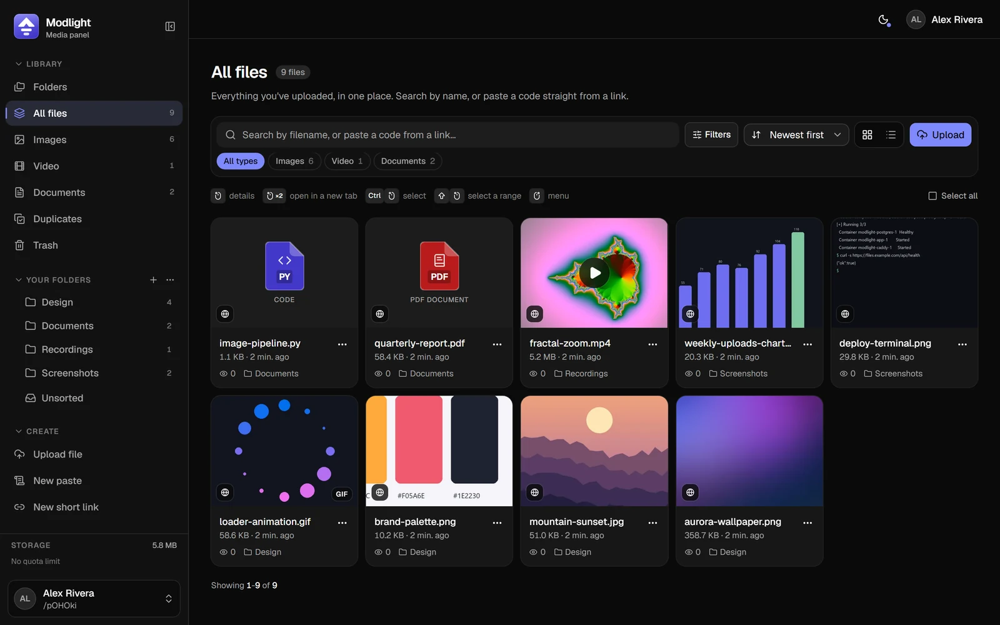
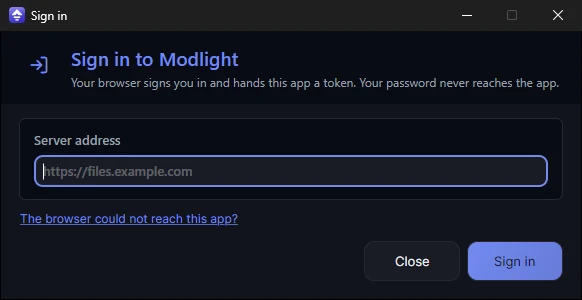

<div align="center">


# Modlight App

**The Windows client for your own Modlight server.**

Capture your screen, record it, download videos, upload anything,<br>
and browse your whole library without opening a browser.

[](LICENSE.txt)


**It needs a server** → **[Modlight](https://github.com/Nimfek/Modlight)**: the self-hosted
panel and API this app signs in to. It installs with one script and Docker.

</div>

<p align="center">
  
</p>

---

## What it is

Modlight App is a fork of **[ShareX](https://github.com/ShareX/ShareX)**. Every capture and
editing tool ShareX has is still here. What changed is the interface, rebuilt in
[Avalonia](https://avaloniaui.net), and that it treats a [Modlight](https://github.com/Nimfek/Modlight)
server as your account rather than as one uploader among eighty.

You install it, type your server's address, sign in through your browser, and from then on
every screenshot, recording or download lands in your library with its link on your clipboard.

## Features

**Your library on the desktop**
- Folders as tiles you open like in Explorer, files with thumbnails, size, age, views and folder.
- Animated previews of videos and GIFs, and a details drawer with every link format.
- Drag a file onto a folder to move it, drop files from Explorer to upload them there,
  press Delete to send a file to the trash.

**Capture and record**
- Region, window and full-screen capture, screen recording to video or GIF, the ShareX
  image editor and effects, on hotkeys you choose.
- After a capture, copy the image or the link straight from the notification, or click it
  to open the file.

**Uploads you can trust**
- Live progress, speed and time left, plus a history of what went up.
- An offline queue that waits for the network instead of failing, and large files that
  resume where they stopped.

**Downloads**
- Paste a YouTube, TikTok or X link and the video lands in your account: video or audio,
  in the quality you pick. yt-dlp keeps itself up to date.

**One account, synced**
- Sign-in happens in your browser, so two-factor authentication just works.
- Your settings and theme follow you between the panel and the app.
- Short links, pastes with syntax highlighting, account settings and, for administrators,
  a disk overview, all without opening the panel.

<p align="center">
  
  <br><sub>The same library in the <a href="https://github.com/Nimfek/Modlight">Modlight web panel</a>.</sub>
</p>

---

## First run: choose your server and sign in

The app has no server built in. You tell it which one is yours.

1. **Install the app** (below) and start it. **My space** says you are not signed in.
2. Click **Sign in** and type your server's address, for example `files.example.com`.
   Leave out `https://` if you like; the app adds it.
3. Click **Sign in** again. Your browser opens your server's sign-in page: log in there,
   two-factor included, and approve the app.
4. The browser hands the app a token over `127.0.0.1`, and you are done. Your password
   never passes through the app.

<p align="center">
  
</p>

If the browser cannot reach the app (a strict firewall, a remote desktop session), **The
browser could not reach this app?** lets you paste a token created in the panel instead.

No server yet? [Modlight](https://github.com/Nimfek/Modlight) installs with `./setup.sh`
and Docker in a few minutes.

---

## Install

**Requirements:** Windows 11 22H2 or newer, x64. The installer is self-contained, so no
.NET runtime is needed.

Download the installer from this repository's
[Releases](https://github.com/Nimfek/Modlight-App/releases) once one is published, or build
it yourself as described below.

During setup you choose:

- **Optional components**: FFmpeg (screen recording and GIFs), yt-dlp (video downloads) and
  the background-removal model. Each is downloaded over HTTPS and checked against a known
  SHA-256 before it is used. Anything you skip can be added later under **Settings →
  Components**.
- **Importing from ShareX**, if it is installed: its settings, hotkeys and history are
  copied, never moved, and ShareX keeps working untouched.
- Shortcuts, the Explorer **Upload with Modlight** menu, starting with Windows, and whether
  the Print Screen key goes to Modlight instead of the Snipping Tool.

The installer is not code-signed, so Windows SmartScreen may warn about an unknown
publisher. Choose **More info → Run anyway**, or build it yourself.

---

## Build from source

You need the [.NET 10 SDK](https://dotnet.microsoft.com/download) and, for the installer,
[Inno Setup 6](https://jrsoftware.org/isinfo.php).

```bash
git clone https://github.com/Nimfek/Modlight-App.git
cd Modlight-App
dotnet build ShareX/ShareX.csproj -c Release
```

Build the app project, not the whole solution: some upstream projects in the `.sln` do not
target this setup and fail with `NETSDK1047`. The project folders keep their ShareX names on
purpose, so that fixes from upstream still merge; the product and the executable are Modlight.

The result is `ShareX/bin/Release/Modlight.exe`. Run it with `-portable` to keep its
settings next to the executable instead of in your Documents folder, handy beside an
installed copy (`-multi` also allows a second instance).

### Package an installer

```bash
dotnet publish ShareX/ShareX.csproj -c Release -p:Platform=x64
"%LOCALAPPDATA%\Programs\Inno Setup 6\ISCC.exe" ShareX.Setup\InnoSetup\Modlight-setup.iss
```

The installer lands in `Output\Modlight-<version>-setup-x64.exe`. `dotnet publish` produces
a self-contained tree, so whoever installs it needs no .NET runtime. The version comes from
`Directory.build.props`.

### Tests

```bash
dotnet run --project ShareX.Tests -c Release
```

---

## Your server, your build

Out of the box the app asks for a server on the sign-in screen, and automatic updates are
off. That is the right setup for anyone building from source.

**Distributing the app to your own users?** Set `ModlightDefaultHost` to your server. Create
`Modlight.local.props` next to `Directory.build.props`; it is gitignored, so it stays out of
your repository:

```xml
<Project>
  <PropertyGroup>
    <ModlightDefaultHost>https://files.example.com</ModlightDefaultHost>
  </PropertyGroup>
</Project>
```

Or pass it on the command line: `-p:ModlightDefaultHost=https://files.example.com`.

That one value does two things:

- it pre-fills the sign-in screen, so your users only click **Sign in**; another server
  stays one click away under **Other server**;
- it becomes the **only** server that build accepts updates from. That is deliberate: the
  update source is fixed when the app is built and never taken from the sign-in box,
  because a server that can hand the app an installer can get code run on the user's
  machine. Signing in to somebody else's server must not grant them that.

The build rejects a value that is not `https://` or that ends with a slash.

**Updates** come from your Modlight server. Publish an installer with the server's
`publish-release` script (see the server's
[development guide](https://github.com/Nimfek/Modlight/blob/main/docs/development.md#publishing-a-desktop-app-release)).
It records the installer's SHA-256, and the app refuses to run a download that does not
match. To set the publisher link shown in Windows' installed-apps list, pass
`/DMyAppURL=https://…` to the installer compiler.

---

## Security

Please report vulnerabilities privately, as described in [`SECURITY.md`](SECURITY.md).

## License and credits

Licensed under the [GNU General Public License v3.0](LICENSE.txt), as ShareX is. The
original copyright notices are kept in the source files, and third-party licenses are in
[`Licenses/`](Licenses).

- [ShareX](https://github.com/ShareX/ShareX) by the ShareX Team, the application this is built on.
- [Modlight](https://github.com/Nimfek/Modlight), the server this app talks to (AGPL-3.0).
- [Avalonia](https://avaloniaui.net), the UI framework.
- [yt-dlp](https://github.com/yt-dlp/yt-dlp), [FFmpeg](https://ffmpeg.org) and
  [QuickJS](https://bellard.org/quickjs/) (bundled in `Tools/`, used by yt-dlp to solve site
  challenges).

Modlight App is an independent fork, not affiliated with or endorsed by the ShareX Team.
